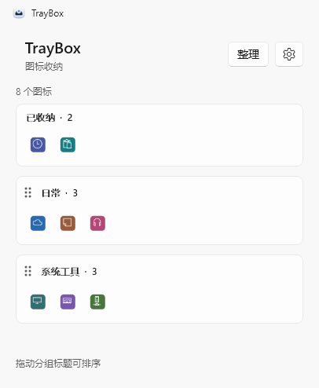
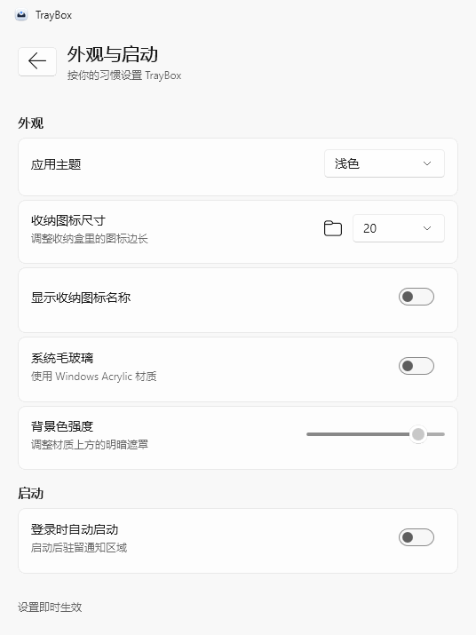

# TrayBox

**Windows 11 通知区域图标收纳 · A tray icon organizer for Windows 11**

[简体中文](#简体中文) · [English](#english)

| 收纳与分组 · Tray and groups | 外观与启动 · Appearance and startup |
| --- | --- |
|  |  |

[深色收纳盒截图 · Dark mode screenshot](docs/screenshots/box-dark.png) · 截图使用示例数据 · Screenshots use demo data

## 简体中文

### 下载

适用于 **Windows 11 x64**。从仓库的 **Releases** 选择一个 ZIP，完整解压后运行 `TrayBox.exe`。程序静默启动，点通知区域的 TrayBox 图标打开收纳盒。

| 下载 | 运行要求 |
| --- | --- |
| `TrayBox-0.21.0-win-x64-portable.zip` | 自带运行库，解压即用 |
| `TrayBox-0.21.0-win-x64-compact.zip` | 已安装 [.NET 10 Desktop Runtime x64](https://dotnet.microsoft.com/en-us/download/dotnet/10.0) |

### 使用

- 拖入图标收纳，拖出恢复，盒内可拖动排序。单击、双击和右键转发给原应用。
- 点击「整理」创建和管理分组，随时可拖动分组标题调整顺序。
- 在「设置 → 外观与启动」调整主题、毛玻璃、尺寸和名称显示。在「图标收纳」查看暂不可收纳的原因。
- 升级或退出时，从托盘右键菜单选择「退出并恢复图标」。

## English

### Download

For **Windows 11 x64**. Pick a ZIP under **Releases**, extract the full folder, and run `TrayBox.exe`. TrayBox starts quietly. Click its notification-area icon to open the box. The current app UI is in Simplified Chinese.

| Download | Requirements |
| --- | --- |
| `TrayBox-0.21.0-win-x64-portable.zip` | Includes the runtimes |
| `TrayBox-0.21.0-win-x64-compact.zip` | Requires [.NET 10 Desktop Runtime x64](https://dotnet.microsoft.com/en-us/download/dotnet/10.0) |

### Use

- Drag icons in to collect them, out to restore them, or within the box to reorder. Clicks and context menus go to the original app.
- Use **整理** to manage groups. Drag a group header any time to reorder it.
- Open **设置 → 外观与启动** for theme, Acrylic, icon size, and labels. **图标收纳** explains why an icon is unavailable.
- Before updating or quitting, choose **退出并恢复图标** in the tray menu to exit and restore icons.

[第三方声明 · Third-party notices](THIRD-PARTY.md)
